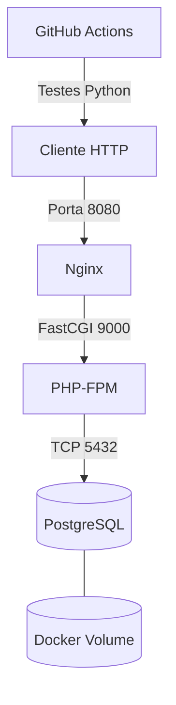

# 🐳 DevOps Docker Lab

[](https://github.com/RegisFredFilho/devops-docker-lab/actions/workflows/ci.yml)

Laboratório de estudos em DevOps com Docker, Docker Compose,
PHP, Nginx, PostgreSQL, Python e GitHub Actions.

## 🎯 Objetivo

Desenvolver conhecimentos práticos de containerização,
redes Docker, persistência de dados, testes automatizados
e integração contínua (CI).

O projeto foi desenvolvido em uma VM Debian hospedada
em um servidor Proxmox VE.

## 🛠️ Stack

| Tecnologia | Utilização |
|---|---|
| Docker | Containerização |
| Docker Compose | Gerenciamento dos serviços |
| PHP 8.4 | Aplicação HTTP |
| Nginx | Servidor web |
| PostgreSQL 17 | Banco de dados |
| Python 3 | Automação de testes |
| Pytest | Framework de testes |
| GitHub Actions | Integração contínua |
| Proxmox VE | Infraestrutura do laboratório |

## 🏗️ Arquitetura



A aplicação utiliza uma rede interna Docker para
comunicação entre os serviços.

O PostgreSQL utiliza um volume nomeado para persistência.

## 📂 Estrutura

```text
devops-docker-lab/
├── .github/
│   └── workflows/
│       └── ci.yml
├── app/
│   └── index.php
├── nginx/
│   └── default.conf
├── tests/
│   ├── test_api.py
│   └── requirements.txt
├── Dockerfile
├── compose.yaml
├── .env.example
├── .gitignore
└── README.md
```

## 🚀 Executando a aplicação

### Requisitos

- Docker Engine
- Docker Compose
- Git
- Python 3 e venv (para testes locais)

### 1. Clonar o repositório

```bash
git clone https://github.com/RegisFredFilho/devops-docker-lab.git
cd devops-docker-lab
```

### 2. Configurar as variáveis de ambiente

```bash
cp .env.example .env
```

Edite o arquivo `.env` e configure uma senha própria
para o PostgreSQL.

### 3. Iniciar os containers

```bash
docker compose up -d --build
```

### 4. Verificar os serviços

```bash
docker compose ps
```

### 5. Testar a aplicação

```bash
curl -i http://localhost:8080
```

A aplicação deverá retornar HTTP 200 e um JSON
indicando que a conexão com PostgreSQL está ativa.

## 🧪 Testes automatizados

Criar um ambiente virtual Python:

```bash
python3 -m venv .venv
source .venv/bin/activate
```

Instalar as dependências:

```bash
python -m pip install -r tests/requirements.txt
```

Executar os testes:

```bash
python -m pytest tests/test_api.py -v
```

Os seis testes verificam:

- Código HTTP 200
- Status da aplicação
- Nome do projeto
- Conexão com PostgreSQL
- Versão do PHP
- Content-Type JSON

## ⚙️ Integração contínua

O GitHub Actions executa automaticamente a pipeline
em push e Pull Requests para a branch main.

Etapas:

1. Checkout do repositório
2. Configuração do Python
3. Instalação das dependências
4. Inicialização dos containers
5. Verificação da disponibilidade HTTP
6. Execução dos testes com pytest
7. Coleta de logs em caso de falha
8. Encerramento dos containers

O workflow utiliza permissões restritas:

```yaml
permissions:
  contents: read
```

## 🔒 Segurança

- Credenciais reais não são versionadas
- Arquivos .env são ignorados pelo Git
- PostgreSQL não possui porta publicada no host
- A branch main exige verificações de CI aprovadas
- O laboratório não foi projetado para produção

## 🔍 Troubleshooting

### A aplicação não responde

```bash
docker compose ps
docker compose logs --tail=100
```

### Verificar os logs do PHP

```bash
docker compose logs app
```

### Verificar a integridade do PostgreSQL

```bash
docker compose ps db
```

### Resposta JSON inválida

Verificar mensagens de erro PHP e caracteres
indevidos antes da abertura `<?php`.

## 📚 Aprendizados

Durante o desenvolvimento foram praticados:

- Construção de imagens personalizadas
- Redes internas Docker
- Volumes e persistência
- Diagnóstico de falhas
- Testes de integração
- Git e estratégias de branches
- GitHub Actions
- Branch protection
- Princípio do menor privilégio
